# Battlefront — Jak 3

<p align="center">
  
  
  
</p>

> **Contents:** [Overview](#overview) · [Key Features](#key-features) · [How to Play](#how-to-play) · [Download & Play](#download--play-via-opengoal-launcher-players) · [Developer Setup](#developer-setup--local-compilation) · [Demo Video](#demonstration-video) · [Technical Documentation](#technical-documentation)

---

## Overview
Battlefront for Jak 3: the Freedom League and the Krimzon Guard fight over a war zone with up to 1000 units each, and you play any class of either side.

<p align="center">
  
</p>

- **Target Game:** Jak 3
- **Repository:** [`whozghiar/jak3-mod-battlefront`](https://github.com/whozghiar/jak3-mod-battlefront), created from the modding base [`whozghiar/jak-project`](https://github.com/whozghiar/jak-project)

## Key Features
- **Battles over the whole of Haven City:** pick a side and a class; the battlefield is the whole city. Force fields close the ruins of the old town (toward the stadium) and the Metal Head nest, and every door to an interior or the sewers stays shut. Each side starts with the units of the battle setup, 500 by default; every death takes one, and a side down to 0 loses. Up to 40 units per side fight at once, all over the city, and they stay on the battlefield wherever you look.
- **A Battlefront game from the title:** after the opening scenes, START on the title screen opens the game's title menu with the battle's entries: **Start a battle**, **Options** (the game's own), **Quit**. Every page of the battle is a page of the game's START menu, inside its ring, in its colors. Start a battle leads to the war zone, then to the **battle setup**: the time limit (none, 5, 10, 15, 20 or 30 minutes), the units per side (50 to 1000 by 50, 500 by default), the victory condition (**Control points**: a side holding every control point for 20 seconds wins; **Units wiped out**: only a side out of units loses), the special characters (No: none yet), the city's map with its points, and the two sides, the Freedom League and the Krimzon Guard, never the same. **Next** opens the class page, before the battle: pick your class there, then **Start the battle** loads the city and opens the class page, whose button reads **Start the battle**. When the time runs out, the side holding more control points wins; on a tie, the one with more units left. A side out of units loses in any case.
- **Battle points:** each side has a base (the Freedom League's at the entrance of its headquarters, the Krimzon Guard's in the middle of the Port), and each district has two control points: the Port and the Port Gate, the North Industrial Zone and the Industrial Zone, the South Industrial Zone and the Slums, the Sewer Exit and Freedom HQ. They are neutral at the start, each a beam of light in its holder's color (white while neutral). A side with more units than the other within 35 m of a point for 30 seconds captures it. Units run there across the districts, a robotguard rolling as a ball while its point is over 35 m away, each to one of the three points their side does not hold nearest its base, drawn at random, so they spread over the front; a point under attack near them comes first, until the other side's units are gone from it. A few units stay to guard a point their side took, three at most, while the enemy comes near.
- **Armies everywhere:** as in Star Wars Battlefront, each side's units come in from its command posts: new units come down three at a time at most, half of them at a point of the side under attack, to defend it, the others at its most advanced control point, the nearest the enemy's base. They come down from the sky anywhere within 250 m of the point, so the fights spread over the city (a jetpack guard never onto the Industrial Zone's walkways); some guard it while the enemy comes near, the others march on to the next point, and in the Industrial Zone some go by the walkways up its stairs. A fallen unit's place is filled 5 seconds after it falls. During a battle every street district of Haven City stays loaded, so the units fight at every point at once, near you or not. About 40 units per side fight at once; every unit, yours too, moves one and a half times as fast as in the game. No traffic cars or citizens fill the streets during a battle.
- **Troop transports:** each side's units arrive at its starting base by the A-G troop transport of Jak 2, red for the Krimzon Guard and blue for the Freedom League, hovering right above it. Out of the ship they come down each their own way: a guard jumps down, a robotguard rolls out as a ball, a spider robot drops, a jetpack guard flies out. At a control point the side holds there is no ship: its units drop from the sky, 30 m up, onto the walkable ground around it, platforms included: a guard lands with a jump, a robotguard falls as a ball, a spider robot tumbles down, a jetpack guard flies down.
- **Two armies:** the Freedom League (blue guards, jetpack guards) against the Krimzon Guard (red Krimzon Guards from Jak 2, jetpack guards, robotguards, spider robots). The red guards carry the same rifle and grenade launcher as the blue ones, and only the blue guards shout the Jak 3 guards' battle lines.
- **Fast armies:** guards run 1.6 times as fast as the game's, robotguards 3 times on foot and 2.25 times as a ball, spider robots 2.4 times, jetpack guards 1.5 times. Your classes are as fast: a guard runs 1.7 times as fast as Jak, the robotguard 2.1 times on foot and 5.4 times as a ball, the spider robot 3.6 times; the jetpack keeps its pace. Every walker's legs step at its speed, without sliding.
- **Play any class:** each of the six classes has its own model, moves and weapons, previewed turning on the class page with what it does and its own buttons, shown as the pad's icons: switch between tazer, rifle and grenade launcher, crouch for a steadier aim, dodge and roll as a guard, fly as long as you like on two flames, boost on dark eco and fire rockets with the jetpack, roll as a ball and raise a red shield as a robotguard, or leap 11 m high and sprint on blue eco as a spider robot.
- **Aimed shots:** every class that shoots faces the crosshair and points its weapon at it as it fires. A guard's shots spread around the crosshair: a little standing, more on the move or in a dodge, least crouched; the crosshair grows and shrinks with the spread.
- **A third-person shooter camera:** as in Star Wars Battlefront (2004), over your class's right shoulder. The right stick turns it left and right and tilts it up and down, the crosshair stays in the middle of the screen, and your class faces where you aim while the left stick moves it forward, back and sideways. Hold L3 and push the right stick down to pull the camera back, up to nearly twice as far; up brings it back in, as close as at the start.
- **Free aim:** every class shoots where the crosshair points; only the tazer locks onto the nearest foe by itself.
- **Health and damage on one 24 point scale:** guards and robotguards have 24 points, jetpack guards 18, spider robots 12; each class's points fill its whole health ring, so every class starts with a full ring. A rifle shot takes 8, a grenade 20, the tazer 24, a close attack 10 (the spider's headbutt 24, as the tazer), a jetpack's shot 6 and a robotguard's shot 4; your own shots and blows deal twice that to the battle's units. Running into a foe does not hurt it. A health pickup gives back 3 points. When you are hit, or hurt by a fall, your class cries, not Jak: a guard's voice, the robotguard's metal rattle, the spider's jabber.
- **Friends and foes:** your side never hurts or targets you; the enemy goes for you when you come within 50 m; every unit attacks the foe it sees best, the nearest, and turns onto a nearer one as it comes; a foe a wall hides is left alone.
- **Ammo and pickups:** a guard's rifle holds 20 rounds with 5 magazines more carried (100 rounds), its grenade launcher 5 grenades; the tazer needs no ammo but recharges for 20 s after each strike. The battle's guards on both sides carry rifles and grenade launchers: the tazer is yours alone. Six fallen units in every ten drop something: dark eco, which refills a jetpack's boost, 3 times in 10; ammo 4 times in 10 (rifle rounds 60 %, grenades 30 %, blue ammo 10 %, which recharges the tazer at once); health 3 times in 10. One fallen jetpack guard in ten also drops its rockets, as the dark gun's purple ammo: 5 rockets for a jetpack, up to 10. A pickup pops up from where the unit fell and drops to the ground under it, a jetpack guard's from the air too, and vanishes 10 seconds after it appears.
- **A soldier's HUD:** the reserves at the top, in a sci-fi meter shaped as a wide T: the Freedom League's bar in blue fills to the left, the Krimzon Guard's in red to the right, the two counts in the compartment under its middle; the control point whose capture zone you stand in, its letter and its capture in percent under it; the crosshair, your gun's icon at the top right with its rounds as shells and a count (20/100 for the rifle, the grenades left, nothing for the tazer but its recharge seconds; for a jetpack guard a purple rocket, its rockets as shells and the count left), and your class's gauge in Jak's eco gauges: jetpack boost as dark eco, spider blue eco in blue, robotguard shield in red.
- **Outside the campaign:** during a battle no mission can start, no vehicle can be taken, and Save, Load Game and Secrets are greyed out in the START menu.
- **The streets only:** doors to the interiors stay shut, and no mission, vehicle, parked car, precursor orb or crate is there. A ceiling keeps the jetpacks over the streets, and the jetpack guards of both armies fly no higher than a troop transport.
- **Jak 2 models in Jak 3:** the red Krimzon Guard and the jetpack guard of Jak 2.
- **Score and map on L3:** L3 shows your kills and deaths where the game shows its orb and skull gem counters, and the whole city's map, live, with the points and both armies; the game's minimap at the bottom right makes way for it; L3 again hides them and brings the minimap back. L3 + SELECT still opens the Mods menu.
- **One map everywhere:** every page and L3 show the same map, the city's own map. Its marks are small, for a map you can read. Each control point is a glowing ring around a disc in its holder's color, blue for the Freedom League, red for the Krimzon Guard, grey while neutral, its letter in white inside it; each base a disc of its side's color; each unit a small dot of its side's color, Jak a white one. During a battle it is live, and a point a side is taking blinks. The game's minimap marks the control points the same way, blinking too.
- **Watch, then respawn where you like:** when you fall, your class dies its own way, with its own cry, the camera looking down at it: a guard falls and dissolves in purple sparks (the enemy's red guards too, as the blue ones), the robotguard explodes, a jetpack guard fades and then explodes, the spider explodes. Then the camera follows one of your side's units, and a frame on the right shows where you come back and as which class: your last respawn point (your base when your side lost it) and your last class. X respawns you there at once. Triangle opens the **Respawn** page first: X picks your class on the left, the cursor goes down to your respawn point, your base or a control point your side holds, picked with the D-pad and lit on the map; Triangle there goes back. **Spawn** drops you from the sky onto the ground around it, at a random spot, with your class and fresh ammo: your controls come back once you land, as your class plays its landing.
- **Spawn shield:** the fall from the sky never hurts you, and for 3 seconds after you deploy or land after a respawn nothing hurts you and your class blinks; it stops blinking when the shield ends.
- **Redeploy:** at any moment of a fight, START > **Redeploy** opens the same Respawn page, your class and your respawn point; Triangle goes back to the START page. This is where you change class. Out of combat for 30 seconds it is free; in combat it costs your side a unit ("Redeploy (lose a unit)").
- **START opens the battle's page:** while the mode is on, START opens the battle's own page, with the city's map as it stands. The battle never pauses: it goes on behind every menu you open during it, the Respawn page and the game's own menu included. Its last entry, **Options**, opens the game's START menu, where saving, loading and restarting a mission stay shut during a battle.
- **War music:** the city's own war music, the one of its assaults, plays everywhere during a battle.
- **On by default:** the mode is on at every boot, and its title menu replaces the game's. Switching it off in the Mods menu (L3 + SELECT) during a battle loads your last save, and gives you the game back until the next boot.

## How to Play
1. Boot the game, skip the opening scenes with Triangle and press START on the title screen: the title menu lists **Start a battle**, **Options** and **Quit**. Choose **Start a battle**.
2. Choose the war zone: Haven City (Spargus is listed, greyed, for a later version).
3. Set the battle up: time limit, units per side, victory condition, and your side on top (Left and Right change a setting); the city's map shows both bases and the control points. **Next**, or Triangle to go back.
4. The class page follows, in three columns: on the left the classes and, under them, what the class under the cursor does with its buttons; in the middle the reserves and a picture of the class, the button under it; on the right the objective and the map. **Start the battle** loads the whole city ("Loading the war zone...", about 5 seconds) and puts you in as that class with fresh ammo.
5. The reserves of both sides are shown at the top of the screen: the Freedom League's bar in blue filling to the left, the Krimzon Guard's in red to the right, the counts under them. Under them, while you stand in a control point's capture zone, its letter in its holder's color and its capture in percent. The control points are A to H, from the Krimzon Guard's base to the Freedom League's (A Port, B Port Gate, C North Industrial Zone, D Industrial Zone, E South Industrial Zone, F Slums, G Sewer Exit, H Freedom HQ).
6. When you fall, you watch the battle; the frame on the right shows your respawn point and class. X respawns you there at once. Triangle opens the **Respawn** page: X on a class picks it and moves the cursor to the **Respawn point** row, whose Left and Right pick your base or one of the control points your side holds, lit on the map; X there deploys you with fresh ammo, Triangle goes back.
7. During a battle, START opens the battle's page, over the city's live map: **Resume**, **New battle** (greyed during a battle; out of one, the war zone, your side and your class), **Redeploy** (the Respawn page, your class and respawn point; free once you have been out of combat for 30 seconds, a unit lost before that), **Restart the battle**, **Quit the battle** (back to the title menu), and **Options** for the game's own START menu. L3 shows your kills, your deaths and the whole map.
8. Switching the mode off in the Mods menu during a battle loads your last save.

<p align="center">
  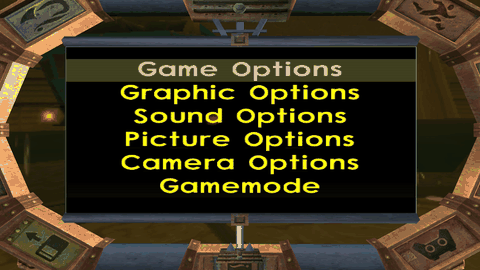
  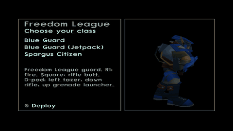
</p>

When a side wins, the result page shows the winner and the losses of both sides; X ends the battle and brings you back to the title menu: Start a battle, Options, Quit.

### The battlefield

The whole of Haven City. Every street district stays loaded during a battle, the units with it; the ruins of the old town and the Metal Head nest stay closed. After the battle the game loads the city around you as usual.

| Point | Where |
|---|---|
| Freedom League base | the entrance of the Freedom League's headquarters |
| Krimzon Guard base | the middle of the Port |
| A: Port | a street of the Port, between its docks |
| B: Industrial Zone | the middle of the Industrial Zone |
| C: Slums | the old slums by the Industrial Zone |
| D: Freedom HQ | the slums south of the headquarters |

| Port | Industrial Zone |
|---|---|
| 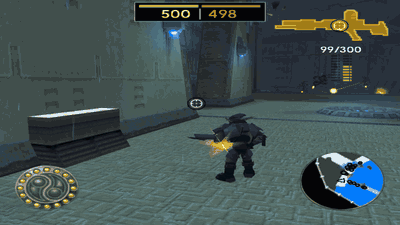 | 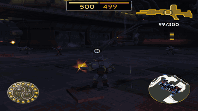 |
| **Slums** | **Freedom HQ** |
| 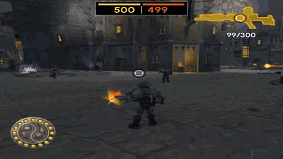 | 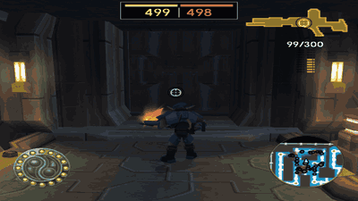 |

*Recorded in game in an earlier version, when a battle held one district: its streets are the same.*

<p align="center">
  
</p>

### Classes

| Class | Controls |
|---|---|
| Blue Guard, Red Krimzon Guard | 24 points. R1: fire. Each rifle shot is the guards' own, on the whole body: you stop and face the crosshair as you fire. The rifle holds 20 rounds, with 5 magazines more carried (20/100), and the guard reloads from them when the magazine is empty, or at any time with Triangle. The grenade launcher throws the 5 grenades you carry as the guards throw theirs: you stop, face the crosshair and throw. The tazer strikes once, 24 points (a whole health bar) within 12 m, you standing still: the foe is electrocuted, arcs around it, and falls; then it recharges for 20 s, with no reload. Square: rifle butt within 5 m, one every 1.5 s. Hold L1: crouch, kneeling and still, for a steadier aim. X: one jump, at least as high as Jak's whole jump (3.5 m) when tapped, up to 4.5 m held; no second jump in the air. L2 + left stick left or right: a strafe to that side, a small sideways hop, still facing the crosshair. R2 + left stick left or right: a roll to that side, head over heels. With the stick ahead, back or at rest, L2 and R2 do nothing. The tazer's strike plays the guard's whole stab. D-pad: left tazer (the guard holds a short stun baton), down rifle, up grenade launcher |
| Jetpack guards | 18 points. It sounds as the battle's jetpack guards: their engine, louder and higher as it speeds up, and their jets, louder while it boosts; its flames point down under its turbines. Hold X to climb, hold Circle to come down, let go of both to hover, for as long as you like. Hold R2: boost toward the left stick (ahead when it rests) while the gauge lasts, 10 s in a full one; only dark eco refills it. Its two flames grow while it boosts. The jetpack always floats a little above the ground. R1: two quick shots. L1: a rocket, straight to the crosshair, bursting as the red gun's third level does (20 points); 10 a life, one every 0.8 s, and 5 more in a fallen jetpack guard's rockets. Square does nothing |
| Robotguard | 24 points. As fast as a guard on foot; it does not jump. R1: two shots. Square: a full punch, one every 1.5 s. R2: roll as a ball, more than 2.5 times as fast as it walks, as far as you like; R2 again stands it up. Circle: a red shield for 5 s that stops every shot, blast and blow while you keep moving and firing, then 25 s to recharge, the gauge filling as it does |
| Spider Robot | 12 points. Faster. X: a leap 11 m high, with a robot's metal rattle. Square: a headbutt that shocks as the tazer does (24 points, the foe electrocuted), one a second. Hold R2: blue eco sprint at double speed for 10 s; the gauge refills in 10 s |

Aim with the right stick: pushed right the view turns right, pushed up it looks up (switching a third-person camera inversion in the game's camera options turns that axis the other way). Shots and grenades go where the crosshair points, and it turns red on a foe. The tazer reaches 12 m and aims by itself at the nearest foe in front of you. The rifles spend yellow ammo and the grenade launcher red ammo; the tazer, the jetpacks' and the robotguard's guns need none. Every close attack lands with the sound of Jak's punch. No citizens walk the streets during a battle.

<p align="center">
  
</p>

| Blue Guard | Blue Guard (Jetpack) |
|---|---|
| 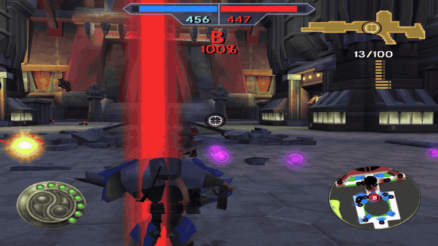 | 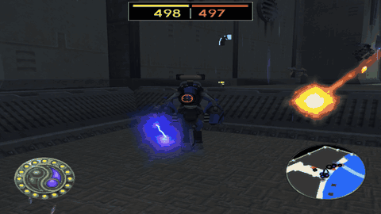 |
| **Red Krimzon Guard** | **Red Krimzon Guard (Jetpack)** |
|  | 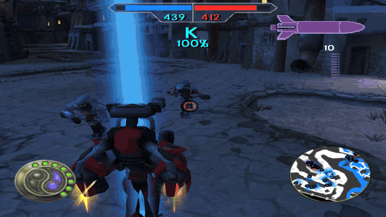 |
| **Robotguard** | **Spider Robot** |
| 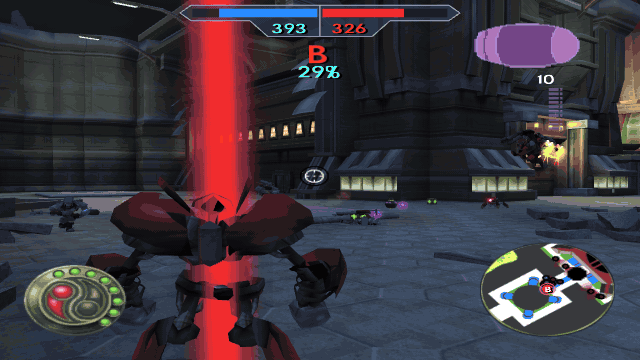 | 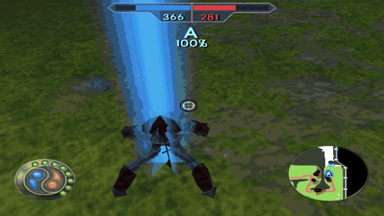 |

*Recorded in game, at the Port: every weapon of every class.*

| Camera | Guard rolls | Jetpack hovering still |
|---|---|---|
| 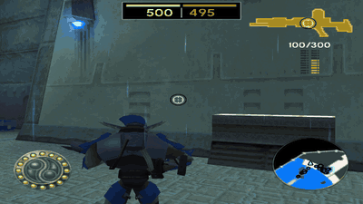 | 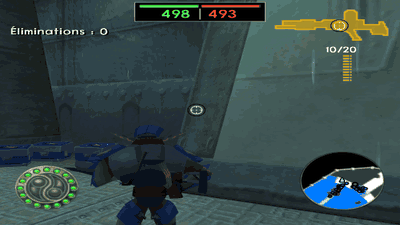 | 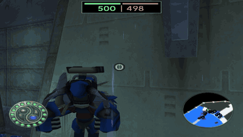 |

*Recorded in game, at the Port.*

Menus are in French when the game language is French.

## Download & Play via OpenGOAL Launcher (Players)

> [!TIP]
> **No developer environment required!** Players can install and play this mod directly using the official OpenGOAL Launcher:

### Option A — Add Custom Mod Source (Recommended)
1. In the **OpenGOAL Launcher**, navigate to **Settings ▸ Mods ▸ Add Custom Mod Source**.
2. Paste this catalog URL:
   ```text
   https://raw.githubusercontent.com/whozghiar/jak3-mod-battlefront/main/index.json
   ```
3. Go to the **Mods** tab, locate **Battlefront**, and click **Install**.
4. Select your clean PS2 game ISO when prompted. The launcher will automatically extract assets and launch the game!

### Option B — Manual Installation from GitHub Releases
1. Download the pre-built package for your operating system from the [Releases](https://github.com/whozghiar/jak3-mod-battlefront/releases) tab (`windows-v*.zip` or `linux-v*.zip`).
2. Extract the archive into your OpenGOAL Launcher features directory:
   - **Windows:** `%APPDATA%\OpenGOAL-Launcher\features\jak3\mods\_local\battlefront\`
   - **Linux:** `~/.config/OpenGOAL-Launcher/features/jak3/mods/_local/battlefront/`
3. Launch the game from the OpenGOAL Launcher.

---

## Developer Setup & Local Compilation

If you want to modify or compile this mod locally from source:

### 0. Get the Source
Already working in a clone of [`whozghiar/jak-project`](https://github.com/whozghiar/jak-project)? Switch to this mod there, keeping your extracted game data:
```bash
task modding-switch -- jak3-mod-battlefront
```
Otherwise clone it on its own; the knowledge base used by AI agents is a submodule, so clone with it:
```bash
git clone --recurse-submodules https://github.com/whozghiar/jak3-mod-battlefront.git
```
To pull the latest modding base into this mod later, run `task modding-sync-branch`.

### 1. Select the Active Game
Make sure your environment is targeting Jak 3:
```bash
task set-game-jak3
```

### 2. Binary Compilation
- **Status:** Required: the mod changes the renderer (`Shadow2.cpp`, so that a battle full of shadows does not stop the game), so build the game with `task build-release-game`.
- **Details:** The decompiler is master-dev's.
```bash
# GOAL-only mod: nothing to build — go straight to the REPL below.
# Engine / compiler C++ changed:
task build-release-game
# Decompiler or decompiler/config changed (then step 3 is mandatory):
task build-release-decomp
```

### 3. Asset Extraction
- **Status:** Required, with your Jak 2 and Jak 3 disc files in `iso_data/jak2` and `iso_data/jak3`.
- **Details:** The Jak 2 models are not in the repository: `task modding-models` makes them from your own discs (`custom_assets/jak3/models/models.jsonc`), then `task extract` bakes them into the Haven City unit levels. A launcher install does both by itself, and needs Jak 2 installed in the launcher.
```bash
task modding-models
task extract
```

### 4. Launch the Game
Run the game natively:
```bash
task boot-game
```
This debug boot skips the title: the battle's title menu opens as soon as Jak stands in the city. `task boot-game-retail` goes through the opening scenes and the title screen, as a player's game does.
*(Or launch via the OpenGOAL REPL using `task repl`, then compile and run with `(mi)` and `(r)`).*

## Demonstration Video

[](https://youtu.be/{YOUTUBE_ID})

**[Watch the demonstration video on YouTube](https://youtu.be/{YOUTUBE_ID})**

> [!NOTE]
> *Demonstration videos must be hosted externally on YouTube to prevent repository bloating. Replace `{YOUTUBE_ID}` with your YouTube video ID (e.g. `MnqnybexhSA` from `https://youtu.be/MnqnybexhSA`).*

## Technical Documentation
For the complete technical breakdown, architecture, developer notes and change log, refer to:
- [`docs/modding/current_mod/battlefront_readme.md`](docs/modding/current_mod/battlefront_readme.md)

---
*(AI-assisted)*
