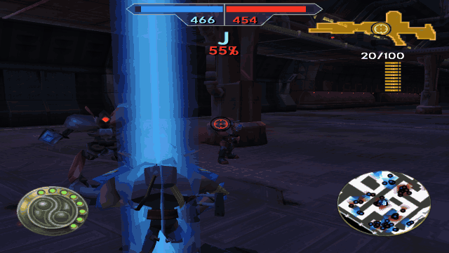
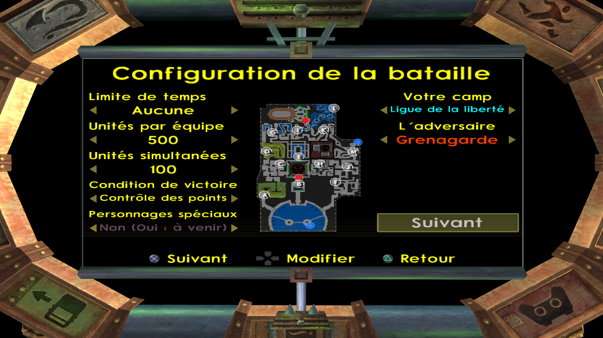
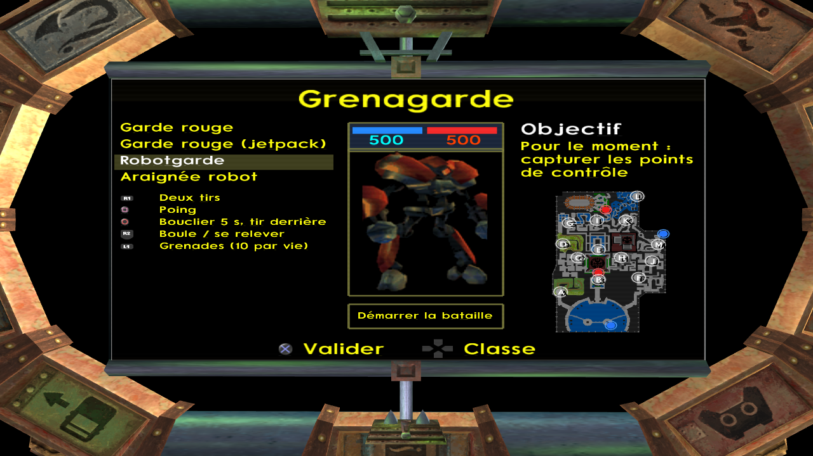
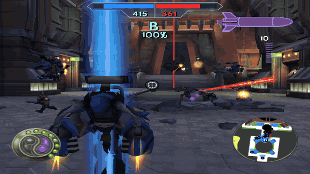
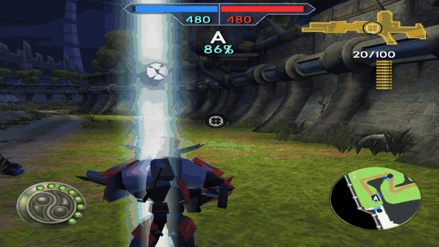
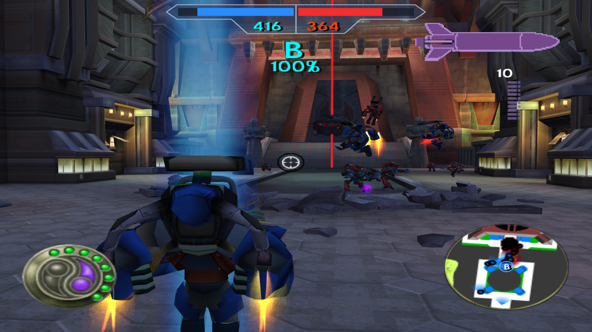
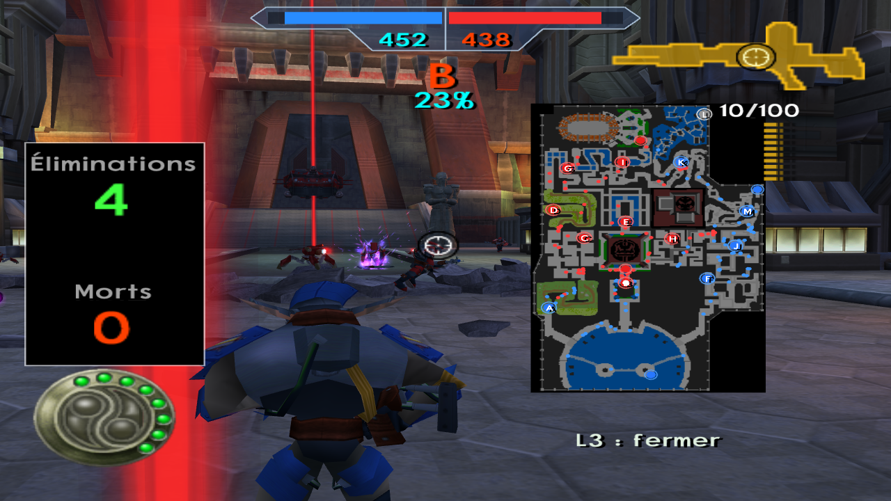
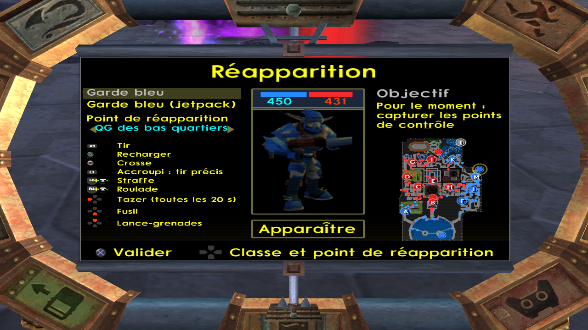
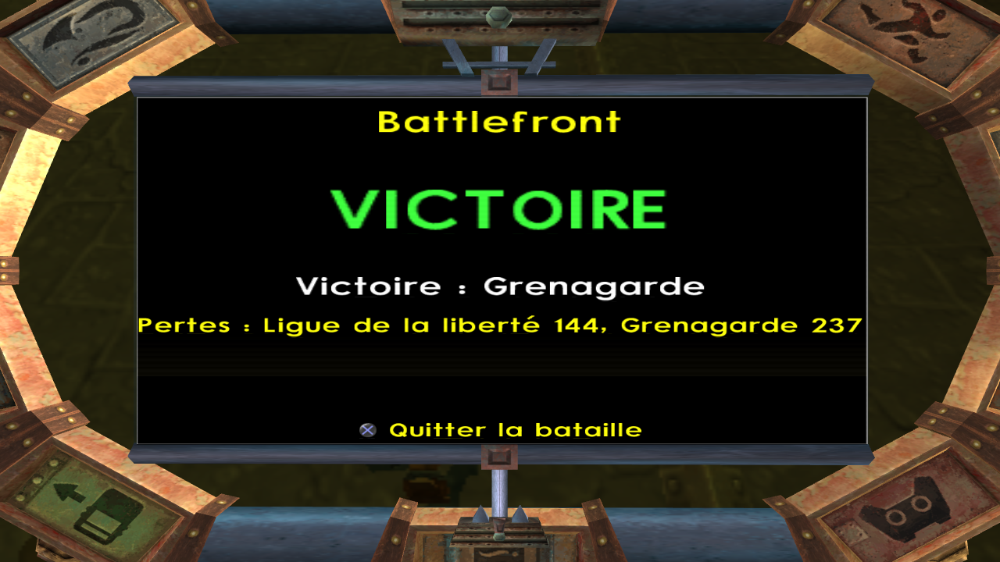

# Battlefront — Jak 3

<p align="center">
  
  
  
</p>

> **Contents:** [Overview](#overview) · [Key Features](#key-features) · [Download & Play](#download--play-via-opengoal-launcher-players) · [Developer Setup](#developer-setup--local-compilation) · [Demo Video](#demonstration-video) · [Technical Documentation](#technical-documentation)

---

## Overview
A Star Wars Battlefront mode for Jak 3. The Freedom League and the Krimzon Guard fight over Jak 2's
Haven City or Spargus, up to 200 units at once, and you play a soldier of either army.

<p align="center">
  
</p>

- **Target Game:** Jak 3, with Jak 2 installed too: the battlefield is built from it.
- **Repository:** [`whozghiar/jak3-mod-battlefront`](https://github.com/whozghiar/jak3-mod-battlefront), created from the modding base [`whozghiar/jak-project`](https://github.com/whozghiar/jak-project)

## Key Features
- **Jak 2's Haven City as the battlefield:** the whole city, built at install from your own Jak 2 and
  Jak 3 discs. Its doors stay closed: the war is in the streets.
- **Spargus as the battlefield:** the desert city, built at install from your Jak 3, without its
  people, its doors to the garage, the arena and the palace closed. A battle of its own there: the
  destruction of an objective. The Freedom League defends a precursor artifact standing in place of
  the white eco fountain, in the middle of the east district, and comes down from the sky around it;
  its units hunt the Krimzon Guard's all over the district. The Krimzon Guard comes down everywhere
  else to destroy it, fighting the blue units that come near. A blue force field walls off the west
  district at the pass: a wall, it harms nobody. Always 30 units a side at
  once; the Freedom League has no tickets, the Krimzon Guard the setup's (500 at most); a fallen
  unit's place waits 5 s. No point is taken: the artifact destroyed
  (its explosion, then the result), the Krimzon Guard wins; the time up, or the Krimzon Guard out of
  units, the Freedom League. The artifact's health shows in a small bar top left.
- **Two armies:** the Freedom League (blue guards, jetpack guards, blue robotguards and spider
  robots, and Ashelin herself when the battle setup lets special characters in) against the Krimzon
  Guard (Jak 2's red guards, jetpack guards, robotguards, spider robots, and Baron Praxis himself
  with special characters). Once a side has lost a tenth of its units, its champion comes to fight
  for it, once a battle: Baron Praxis for the Krimzon Guard, Ashelin for the Freedom League, a health
  bar shown when you are near them. Up to 200 units fight
  at once across the city, half a side, drawn from reserves of 50 to 1000, or unlimited. A unit on
  its way to a point fights the enemies it meets, then goes on. The guards and robotguards fight
  with their guns only, no blows, and a guard aims before it fires. Each side's shots are its color, and
  the top left corner counts each side's units alive. You walk through the units of your side.
- **Capture the city:** each side has two headquarters, and each of the 13 other districts has a
  control point. Bring more units than the enemy near a point: in 20 s an enemy point turns neutral,
  in 15 s a neutral point is yours. Its icon fills in the taking side's color and blinks while both
  sides are even there. Hold every point, or outlast the enemy's reserves, to win.
- **Reinforcements where you hold ground:** a troop transport over each headquarters, in its most
  open ground, drops 100 units, then rises into the sky for good; units fall from the sky at the
  points your side holds, at the one nearest a point under attack first. You respawn at any of them.
- **Nine classes to play,** each with its own model, moves and weapons.
- **A shooter's camera:** third person over the shoulder, free aim with the right stick.
- **A game of its own:** a title menu, a battle setup, class, respawn and result pages in the look of
  the game's menus, in English and French. Missions, vehicles and saving are off during a battle.

<p align="center">
  
  
</p>

### Classes

| Class | Side | Health | Buttons |
|---|---|---|---|
| Guard | Both (blue or red) | 24 | R1 fire, D-pad weapon (rifle 20/100, grenade launcher 5, tazer), Triangle reload, Square rifle butt, X jump, L1 crouch, L2 or R2 + left stick strafe or roll |
| Jetpack guard | Both | 18 | X climb, Circle descend, neither to hover; R1 twin shots, L1 rocket (10), R2 boost on dark eco |
| Robotguard | Both (blue or red) | 24 | R1 twin shots, L1 grenade (10), Square punch, Circle red shield for 5 s, R2 roll as a ball |
| Spider robot | Both (blue or red) | 12 | X 11 m leap, Square shock headbutt on up to 3 foes, R2 blue eco sprint (the blue eco the player's spider kills drop refills it), L1 self-destruct blast once charged |
| Baron Praxis (special character) | Krimzon Guard | 36 | Left stick run (pushed a little: walk; pushed back at a run: he turns about), X jump, Square overhead sword chop, Circle spinning slash, R2 yellow eco ball thrown with a diagonal cut (his yellow gauge), L2 a white barrier: foes thrown out, no damage, a slow walk. In the air: X then Square, he dives and plants his sword in the ground, a blow all around; X then Circle, a full spin of his sword |
| Ashelin (special character) | Freedom League | 36 | Jak's moves. Left stick run, X jump and X again in the air (a flip), R1 both pistols in turn with their recoil, while walking, or running with the stick pushed toward the aim (10 rounds a magazine, 150 carried), Square Jak's punch, lunging ahead, her fingers growing, Triangle reload (one pistol then the other, while she keeps moving), L1 crouch, L1 + left stick roll and X during the roll a long flip, Circle spinning kick, Circle in the air spinning jump kick, R2 + left stick left or right side flip, L2 grenade thrown overhand, flying in an arc, on the run too (10); the stick or a button cuts the end of a move short |

| Blue guard | Blue jetpack guard |
|---|---|
|  |  |
| **Red Krimzon Guard** | **Red jetpack guard** |
|  |  |
| **Robotguard** | **Spider robot** |
|  |  |

### Controls for every class

| Button | Action |
|---|---|
| Right stick | Aim |
| L3 | Your kills and deaths, and the live map of the city |
| R3 held + left stick | Forward: the camera closer; back: farther (you stand still meanwhile) |
| START | The battle menu, battle paused: Redeploy (change class or respawn point), Restart, Quit, Controls (every class's buttons) |

<p align="center">
  
  
  
  
</p>

*Recorded in game, with the game's language set to French.*

## Download & Play via OpenGOAL Launcher (Players)

> [!TIP]
> **No developer environment required!** Players can install and play this mod directly using the official OpenGOAL Launcher:

> [!IMPORTANT]
> Install Jak 2 in the launcher first: the mod builds its battlefield from your Jak 2. Without it,
> the war zone stays greyed.

### Option A — Add Custom Mod Source (Recommended)
1. In the **OpenGOAL Launcher**, navigate to **Settings ▸ Mods ▸ Add Custom Mod Source**.
2. Paste this catalog URL:
   ```text
   https://raw.githubusercontent.com/whozghiar/jak3-mod-battlefront/main/index.json
   ```
3. Go to the **Mods** tab, locate **Battlefront**, and click **Install**.
4. Select your clean PS2 game ISO when prompted. The launcher will automatically extract assets and launch the game!

### Option B — Manual Installation from GitHub Releases
1. Download the pre-built package for your operating system from the [Releases](https://github.com/whozghiar/jak3-mod-battlefront/releases) tab (`windows-v*.zip` or `linux-v*.zip`).
2. Extract the archive into your OpenGOAL Launcher features directory:
   - **Windows:** `%APPDATA%\OpenGOAL-Launcher\features\jak3\mods\_local\battlefront\`
   - **Linux:** `~/.config/OpenGOAL-Launcher/features/jak3/mods/_local/battlefront/`
3. Launch the game from the OpenGOAL Launcher.

Once in the game, skip the opening scenes and press START on the title screen: **Start a battle**.

---

## Developer Setup & Local Compilation

If you want to modify or compile this mod locally from source:

### 0. Get the Source
Already working in a clone of [`whozghiar/jak-project`](https://github.com/whozghiar/jak-project)? Switch to this mod there, keeping your extracted game data:
```bash
task modding-switch -- jak3-mod-battlefront
```
Otherwise clone it on its own; the knowledge base used by AI agents is a submodule, so clone with it:
```bash
git clone --recurse-submodules https://github.com/whozghiar/jak3-mod-battlefront.git
```
To pull the latest modding base into this mod later, run `task modding-sync-branch`.

### 1. Select the Active Game
Make sure your environment is targeting Jak 3:
```bash
task set-game-jak3
```

### 2. Binary Compilation
- **Status:** Required: build everything with `task build-release`.
- **Details:** The mod changes the renderer (`Shadow2.cpp`: a battle full of shadows must not stop the game), and brings the level port tooling of the mod Haven City: New Dawn, which changes the compiler's level builder and the decompiler.
```bash
task build-release
```

### 3. Asset Extraction
- **Status:** Required, with your Jak 2 and Jak 3 disc files in `iso_data/jak2` and `iso_data/jak3`.
- **Details:** No Naughty Dog asset is in the repository. `task modding-models` builds the Jak 2 models from your discs (`custom_assets/jak3/models/models.jsonc`), `task extract` bakes them into Haven City's unit levels, and `task level-port` builds Jak 2's city as a Jak 3 level (`custom_assets/jak3/ports/battlefront-havenj2/port.jsonc`). A launcher install does all of it by itself.
```bash
task modding-models
task extract
task level-port -- custom_assets/jak3/ports/battlefront-havenj2/port.jsonc
```

### 4. Launch the Game
Run the game natively:
```bash
task boot-game
```
This debug boot skips the title: the battle's title menu opens once Jak stands in the city. `task boot-game-retail` goes through the opening scenes and the title screen, as a player's game does.
*(Or launch via the OpenGOAL REPL using `task repl`, then compile and run with `(mi)` and `(r)`).*

## Teaser Video
[](https://youtu.be/0bK9VnEgkxU)

## Demonstration Video

[](https://youtu.be/{VIDEO_ID})


## Technical Documentation
For how the mod works, its engine limits and how to test it, refer to:
- [`docs/modding/current_mod/battlefront_readme.md`](docs/modding/current_mod/battlefront_readme.md): the developer guide
- [`docs/modding/current_mod/battlefront_tests.md`](docs/modding/current_mod/battlefront_tests.md): the smoke tests

---
*(AI-assisted)*
