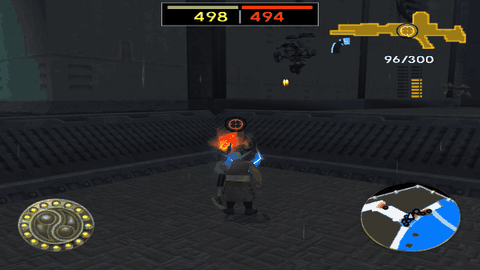

# Battlefront — Jak 3

<p align="center">
  
  
  
</p>

> **Contents:** [Overview](#overview) · [Key Features](#key-features) · [How to Play](#how-to-play) · [Download & Play](#download--play-via-opengoal-launcher-players) · [Developer Setup](#developer-setup--local-compilation) · [Demo Video](#demonstration-video) · [Technical Documentation](#technical-documentation)

---

## Overview
Battlefront for Jak 3: the Freedom League and the Krimzon Guard fight over a war zone with 500 units each, and you play any class of either side.

<p align="center">
  
</p>

- **Target Game:** Jak 3
- **Repository:** [`whozghiar/jak3-mod-battlefront`](https://github.com/whozghiar/jak3-mod-battlefront), created from the modding base [`whozghiar/jak-project`](https://github.com/whozghiar/jak-project)

## Key Features
- **Battles in Haven City:** pick a war zone, a whole district (Port, Industrial Zone, Slums, Freedom HQ), a side, and a class. Each side starts with 500 units; every death takes one, and the first side down to 0 loses. Up to 20 units per side fight at once, and they stay on the battlefield wherever you look.
- **Two armies:** the Freedom League (blue guards, jetpack guards) against the Krimzon Guard (red Krimzon Guards from Jak 2, jetpack guards, robotguards, spider robots). You can also fight as a Spargus citizen.
- **Play any class:** each of the seven classes has its own model, moves and weapons, previewed turning on the class page: switch between tazer, rifle and grenade launcher as a guard, climb, hover and come down on a fuel gauge with the jetpack, roll and raise a red shield as a robotguard, or sprint on blue eco as a spider robot.
- **Free aim:** every class shoots where the crosshair points; only the tazer locks onto the nearest foe by itself.
- **Ammo and pickups:** the guns use Jak's ammo (yellow for the rifles, red for grenades, blue for the tazer). Fallen units drop ammo, health, and now and then dark eco, which refills a jetpack.
- **A soldier's HUD:** the reserves at the top, as bars in the style of Star Wars Battlefront (2004) (yours in green, the enemy's in red), the crosshair, your gun's icon, shells and ammo at the top right, as in the original game, and your class's gauge in Jak's eco gauges: jetpack fuel as dark eco, spider blue eco in blue, robotguard roll in red.
- **Outside the campaign:** during a battle no mission can start, no vehicle can be taken, and saving is off; loading a save ends the battle.
- **A force field** keeps you in the district and the jetpacks under its ceiling. Every street of the district is yours to fight in.
- **Jak 2 models in Jak 3:** the red Krimzon Guard and the jetpack guard of Jak 2.
- **Watch, then respawn:** when you fall, the camera follows one of your side's units for 4 seconds, then you are back at your spawn with your class and fresh ammo.
- **Off by default:** nothing changes until you turn it on in the Mods menu.

## How to Play
1. In game, open the Mods menu with **L1 + SELECT**, then switch on **battlefront > Battlefront mode**.
2. Open the START menu: **Options > Gamemode > Battlefront > New battle**.
3. Choose the war zone, then your side; the whole district is shown on its minimap, with both spawns. You are taken to your side's spawn.
4. Choose your class: the class under the cursor turns in a frame next to the list. X deploys you with fresh ammo.
5. The reserves of both sides are shown at the top of the screen: your side's bar and count in green, the enemy's in red. A force field holds you inside the district.
6. When you fall, you watch the battle for 4 seconds, then you come back at your spawn as the same class, with fresh ammo.
7. During a battle, the same START page has **Change class** (the battle goes on), **Restart the battle** and **Quit the battle**.
8. Switching the mode off in the Mods menu during a battle loads your last save.

<p align="center">
  
  
</p>

When a side's reserve reaches 0, the result page shows the winner and the losses of both sides; X ends the battle and gives you the city back.

### War zones

Each war zone is a whole district of Haven City: every street of it is yours, and the force field only stops you at its border with the next district.

| War zone | Freedom League spawn | Krimzon Guard spawn |
|---|---|---|
| Port | west docks | east docks, by the Krimzon Guard's war zone |
| Industrial Zone | north end | south end, near the Port |
| Slums | an alley on the east edge | west side |
| Freedom HQ | the Freedom League's headquarters | the slums south of it |

| Port | Industrial Zone |
|---|---|
|  |  |
| **Slums** | **Freedom HQ** |
|  |  |

*Recorded in game: a run from the spawn, then runs from other spots of the district.*

<p align="center">
  
</p>

### Classes

| Class | Controls |
|---|---|
| Blue Guard, Red Krimzon Guard | R1: fire, while you walk. The rifle holds 6 shots and the grenade launcher 2: the guard reloads when one is empty. Square: rifle butt. D-pad: left tazer, down rifle, up grenade launcher |
| Jetpack guards | Hold X to climb, hold Circle to come down, let go of both to hover, while the fuel lasts; out of fuel you float down slowly. The gauge refills on the ground in 10 s, or at once with dark eco. The jetpack always floats a little above the ground. R1: two quick shots. Square: dive kick |
| Spargus Citizen | Faster run. R1: rifle. Square: rifle butt |
| Robotguard | Slower. R1: two shots. Square: a full punch. R2: roll as a ball, fast and shot-proof, then 5 s to recharge. Hold Circle: a red shield that breaks when shot; behind it you stand still and cannot shoot |
| Spider Robot | Faster, jumps higher. Circle: bite. Hold R2: blue eco sprint at double speed; the gauge refills in 10 s |

Aim with the camera: shots and grenades go where the crosshair points, and it turns red on a foe. The tazer reaches 12 m and aims by itself at the nearest foe in front of you. The rifles spend yellow ammo, the grenade launcher red ammo, the tazer blue ammo; the jetpacks' and the robotguard's guns need none. No citizens walk the streets during a battle.

<p align="center">
  
</p>

| Blue Guard | Blue Guard (Jetpack) |
|---|---|
|  |  |
| **Spargus Citizen** | **Red Krimzon Guard** |
|  |  |
| **Red Krimzon Guard (Jetpack)** | **Robotguard** |
|  |  |
| **Spider Robot** | |
|  | |

*Recorded in game, at the Port: every weapon of every class.*

Menus are in French when the game language is French.

## Download & Play via OpenGOAL Launcher (Players)

> [!TIP]
> **No developer environment required!** Players can install and play this mod directly using the official OpenGOAL Launcher:

### Option A — Add Custom Mod Source (Recommended)
1. In the **OpenGOAL Launcher**, navigate to **Settings ▸ Mods ▸ Add Custom Mod Source**.
2. Paste this catalog URL:
   ```text
   https://raw.githubusercontent.com/whozghiar/jak3-mod-battlefront/main/index.json
   ```
3. Go to the **Mods** tab, locate **Battlefront**, and click **Install**.
4. Select your clean PS2 game ISO when prompted. The launcher will automatically extract assets and launch the game!

### Option B — Manual Installation from GitHub Releases
1. Download the pre-built package for your operating system from the [Releases](https://github.com/whozghiar/jak3-mod-battlefront/releases) tab (`windows-v*.zip` or `linux-v*.zip`).
2. Extract the archive into your OpenGOAL Launcher features directory:
   - **Windows:** `%APPDATA%\OpenGOAL-Launcher\features\jak3\mods\_local\battlefront\`
   - **Linux:** `~/.config/OpenGOAL-Launcher/features/jak3/mods/_local/battlefront/`
3. Launch the game from the OpenGOAL Launcher.

---

## Developer Setup & Local Compilation

If you want to modify or compile this mod locally from source:

### 0. Get the Source
Already working in a clone of [`whozghiar/jak-project`](https://github.com/whozghiar/jak-project)? Switch to this mod there, keeping your extracted game data:
```bash
task modding-switch -- jak3-mod-battlefront
```
Otherwise clone it on its own; the knowledge base used by AI agents is a submodule, so clone with it:
```bash
git clone --recurse-submodules https://github.com/whozghiar/jak3-mod-battlefront.git
```
To pull the latest modding base into this mod later, run `task modding-sync-branch`.

### 1. Select the Active Game
Make sure your environment is targeting Jak 3:
```bash
task set-game-jak3
```

### 2. Binary Compilation
- **Status:** Required: the mod changes the renderer (`Shadow2.cpp`, so that a battle full of shadows does not stop the game), so build the game with `task build-release-game`. It also changes `decompiler/config`, so step 3 is mandatory.
- **Details:** The decompiler must include master-dev's `extra_art_groups_by_dgo` support.
```bash
# GOAL-only mod: nothing to build — go straight to the REPL below.
# Engine / compiler C++ changed:
task build-release-game
# Decompiler or decompiler/config changed (then step 3 is mandatory):
task build-release-decomp
```

### 3. Asset Extraction
- **Status:** Required (`task extract`).
- **Details:** Bakes the Jak 2 models (`custom_assets/jak3/models/ctypesa`, `ctypesc`) and the Spargus citizen's model (for its class) into the Haven City unit levels.
```bash
task extract
```

### 4. Launch the Game
Run the game natively:
```bash
task boot-game
```
*(Or launch via the OpenGOAL REPL using `task repl`, then compile and run with `(mi)` and `(r)`).*

## Demonstration Video

[](https://youtu.be/{YOUTUBE_ID})

**[Watch the demonstration video on YouTube](https://youtu.be/{YOUTUBE_ID})**

> [!NOTE]
> *Demonstration videos must be hosted externally on YouTube to prevent repository bloating. Replace `{YOUTUBE_ID}` with your YouTube video ID (e.g. `MnqnybexhSA` from `https://youtu.be/MnqnybexhSA`).*

## Technical Documentation
For the complete technical breakdown, architecture, developer notes and change log, refer to:
- [`docs/modding/current_mod/battlefront_readme.md`](docs/modding/current_mod/battlefront_readme.md)

---
*(AI-assisted)*
