# Battlefront — Jak 3

<p align="center">
  
  
  
</p>

> **Contents:** [Overview](#overview) · [Key Features](#key-features) · [How to Play](#how-to-play) · [Download & Play](#download--play-via-opengoal-launcher-players) · [Developer Setup](#developer-setup--local-compilation) · [Demo Video](#demonstration-video) · [Technical Documentation](#technical-documentation)

---

## Overview
Battlefront for Jak 3: the Freedom League and the Krimzon Guard fight over a war zone with 500 units each, and you play any class of either side.

<p align="center">
  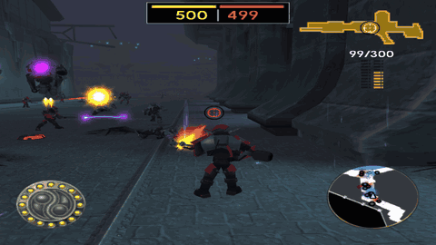
</p>

- **Target Game:** Jak 3
- **Repository:** [`whozghiar/jak3-mod-battlefront`](https://github.com/whozghiar/jak3-mod-battlefront), created from the modding base [`whozghiar/jak-project`](https://github.com/whozghiar/jak-project)

## Key Features
- **Battles over the whole of Haven City:** pick a side and a class; the battlefield is the whole city. Force fields close the ruins of the old town (toward the stadium) and the Metal Head nest, and every door to an interior or the sewers stays shut. Each side starts with 500 units; every death takes one, and the first side down to 0 loses. Up to 40 units per side fight at once, all over the city, and they stay on the battlefield wherever you look.
- **Battle points:** each side has a base (the Freedom League's at the entrance of its headquarters, the Krimzon Guard's on the Port's east docks), and each district has a control point: the Port, the Industrial Zone, the Slums and Freedom HQ. They are neutral at the start, each a beam of light in its holder's color (white while neutral). A side with more units than the other within 15 m of a point for 30 seconds captures it. Units run there on foot, across the districts, to take the nearest point their side does not hold; a point under attack near them comes first, until the other side's units are gone from it. Both sides start at their base: the Freedom League takes Freedom HQ and the Slums, the Krimzon Guard the Port and the Industrial Zone, and the first fight breaks out between the Slums and the Industrial Zone.
- **Armies everywhere:** as in Star Wars Battlefront, each side's units come in from its command posts: each new unit comes down from the ship over the side's point nearest the enemy, where the fight is, and half of them at a point of the side under attack, to defend it. A fallen unit's place is filled 5 seconds after it falls. During a battle every street district of Haven City stays loaded, so the units fight at every point at once, near you or not. About 40 units per side fight at once; every unit, yours too, moves one and a half times as fast as in the game. No traffic cars or citizens fill the streets during a battle.
- **Troop transports:** each side's units arrive by the A-G troop transport of Jak 2, red for the Krimzon Guard and blue for the Freedom League. A transport of its holder hovers over every point near you, base or control point, right above it (each point stands on open ground, nothing above it): when a point changes hands, its ship flies off and the new holder's takes its place. Its units leave it each their own way: a guard jumps down from the hatch, a robotguard rolls out as a ball, a spider robot drops, a jetpack guard flies out.
- **Two armies:** the Freedom League (blue guards, jetpack guards) against the Krimzon Guard (red Krimzon Guards from Jak 2, jetpack guards, robotguards, spider robots).
- **Play any class:** each of the six classes has its own model, moves and weapons, previewed turning on the class page with what it does and its own buttons, shown as the pad's icons: switch between tazer, rifle and grenade launcher, crouch for a steadier aim, dodge and roll as a guard, fly as long as you like and boost on dark eco with the jetpack, roll as a ball and raise a red shield as a robotguard, or leap 11 m high and sprint on blue eco as a spider robot.
- **Aimed shots:** every class that shoots faces the crosshair and points its weapon at it as it fires. A guard's shots spread around the crosshair: a little standing, more on the move or in a dodge, least crouched; the crosshair grows and shrinks with the spread.
- **A third-person shooter camera:** as in Star Wars Battlefront (2004), over your class's right shoulder. The right stick turns it left and right and tilts it up and down, the crosshair stays in the middle of the screen, and your class faces where you aim while the left stick moves it forward, back and sideways.
- **Free aim:** every class shoots where the crosshair points; only the tazer locks onto the nearest foe by itself.
- **Health and damage on one 24 point scale:** guards and robotguards have 24 points, jetpack guards 18, spider robots 12. A rifle shot takes 8, a grenade 20, the tazer 24, a close attack 10 (a spider's bite 12), a jetpack's shot 6 and a robotguard's shot 4. Running into a foe does not hurt it.
- **Friends and foes:** your side never hurts or targets you; the enemy goes for you when you come within 50 m; every unit attacks the foe it sees best, the nearest, and turns onto a nearer one as it comes.
- **Ammo and pickups:** a guard's rifle holds 10 rounds with 20 more carried, its grenade launcher 5 grenades; the tazer needs no ammo but recharges for 20 s after each strike. The battle's guards on both sides carry rifles and grenade launchers: the tazer is yours alone. Six fallen units in every ten drop something, mostly ammo, else health or dark eco, which refills a jetpack's boost; a pickup vanishes 10 seconds after it appears.
- **A soldier's HUD:** the reserves at the top, as bars in the style of Star Wars Battlefront (2004) (yours in green, the enemy's in red), the crosshair, your gun's icon at the top right with its rounds as shells and a count (10/20 for the rifle, the grenades left, nothing for the tazer but its recharge seconds), and your class's gauge in Jak's eco gauges: jetpack boost as dark eco, spider blue eco in blue, robotguard shield in red.
- **Outside the campaign:** during a battle no mission can start, no vehicle can be taken, and Save, Load Game and Secrets are greyed out in the START menu.
- **The streets only:** doors to the interiors stay shut, and no mission, vehicle or parked car is there. A ceiling keeps the jetpacks over the streets.
- **Jak 2 models in Jak 3:** the red Krimzon Guard and the jetpack guard of Jak 2.
- **Score and map on L3:** L3 shows your kills and deaths where the game shows its orb and skull gem counters, and the whole city's map, live, with the points and both armies; the game's minimap at the bottom right makes way for it; L3 again hides them and brings the minimap back. L3 + SELECT still opens the Mods menu.
- **Maps like the minimap:** on every map of the battle each point is a black disc, larger than a unit, ringed in its holder's color, and each unit a disc with its view cone, blue for the Freedom League, red for the Krimzon Guard. On the game's minimap your side's guards and the enemy have their own colors, and each point is a black disc.
- **Watch, then respawn where you like:** when you fall, the camera follows one of your side's units for 4 seconds, then you pick where you come back on the map of the whole city, which shows the units of both sides as they move, your base or a control point your side holds, and deploy there with your class and fresh ammo.
- **Spawn shield:** for 3 seconds after you deploy or respawn, nothing hurts you and your class blinks; it stops blinking when the shield ends.
- **Redeploy:** 30 seconds after your last shot, blow or hit taken, START > **Redeploy** takes you to the same map, without counting a death.
- **START opens the battle's page:** while the mode is on, START pauses the game on the battle's own page, with the city's map as it stands; its last entry, **Game menu**, opens the game's START menu.
- **Off by default:** nothing changes until you turn it on in the Mods menu.

## How to Play
1. In game, open the Mods menu with **L3 + SELECT**, then switch on **battlefront > Battlefront mode**.
2. Press START: the battle's page opens; choose **New battle**.
3. Choose the war zone: Haven City (Spargus is listed, greyed, for a later version), then your side; the whole city is shown on its map, with both bases and the control points.
4. The class page follows at once, while the whole city loads behind it (about 5 seconds): the class under the cursor turns in a frame next to the list as soon as the models are in, its health, what it does and its buttons under the list. Once "Loading the war zone..." gives way to "Deploy", X deploys you with fresh ammo.
5. The reserves of both sides are shown at the top of the screen: your side's bar and count in green, the enemy's in red. Under them, the control points A (Port), B (Industrial Zone), C (Slums) and D (Freedom HQ) in their holder's color, with the capture under way in percent.
6. When you fall, you watch the battle for 4 seconds, then the D-pad picks your base or one of the control points your side holds on the city's map, and X deploys you there. You keep your class and get fresh ammo.
7. During a battle, START opens the same page, over the city's live map: **Resume**, **Change class** (the battle goes on), **Redeploy** once you have been out of combat for 30 seconds, **Restart the battle**, **Quit the battle**, and **Game menu** for the game's own START menu. R3 shows your kills, your deaths and the whole map.
8. Switching the mode off in the Mods menu during a battle loads your last save.

<p align="center">
  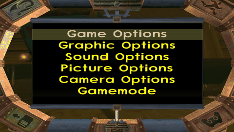
  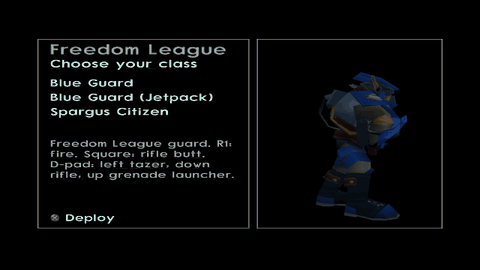
</p>

When a side's reserve reaches 0, the result page shows the winner and the losses of both sides; X ends the battle and gives you the city back.

### The battlefield

The whole of Haven City. Every street district stays loaded during a battle, the units with it; the ruins of the old town and the Metal Head nest stay closed. After the battle the game loads the city around you as usual.

| Point | Where |
|---|---|
| Freedom League base | the entrance of the Freedom League's headquarters |
| Krimzon Guard base | the Port's east docks, by the Krimzon Guard's war zone |
| A: Port | a street of the Port, between its docks |
| B: Industrial Zone | the middle of the Industrial Zone |
| C: Slums | the old slums by the Industrial Zone |
| D: Freedom HQ | the slums south of the headquarters |

| Port | Industrial Zone |
|---|---|
| 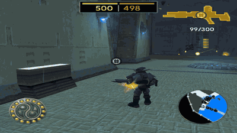 | 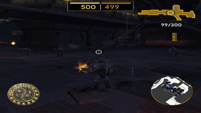 |
| **Slums** | **Freedom HQ** |
| 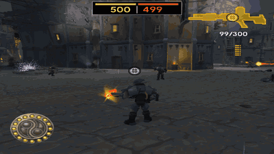 | 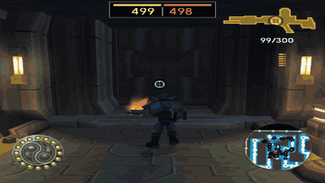 |

*Recorded in game in an earlier version, when a battle held one district: its streets are the same.*

<p align="center">
  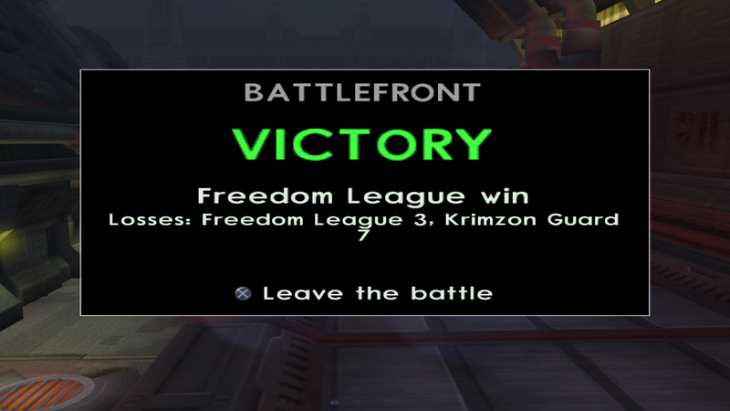
</p>

### Classes

| Class | Controls |
|---|---|
| Blue Guard, Red Krimzon Guard | 24 points. R1: fire, while you walk. The rifle holds 10 rounds, with 20 more carried: the guard reloads from them when the magazine is empty. The grenade launcher throws the 5 grenades you carry. The tazer strikes once, 24 points (a whole health bar) within 12 m, then recharges for 20 s, with no reload. Square: rifle butt, one every 1.5 s. Hold L1: crouch, kneeling and still, for a steadier aim. L2 + left stick: a dodge that way, a sideways jump, still facing the crosshair. R2 + left stick: a roll that way, head over heels. The tazer's strike plays the guard's whole stab. D-pad: left tazer (the guard holds a short stun baton), down rifle, up grenade launcher |
| Jetpack guards | 18 points. Hold X to climb, hold Circle to come down, let go of both to hover, for as long as you like. Hold R2: boost toward the left stick (ahead when it rests) while the gauge lasts, 3 s in a full one; only dark eco refills it. The jetpack always floats a little above the ground. R1: two quick shots. Square: dive kick |
| Robotguard | 24 points. Slower. R1: two shots. Square: a full punch, one every 1.5 s. R2: roll as a ball, as far as you like; R2 again stands it up. Circle: a red shield for 5 s that stops every shot, blast and blow while you keep moving, then 25 s to recharge |
| Spider Robot | 12 points. Faster. X: a leap 11 m high. Circle: bite, one a second. Hold R2: blue eco sprint at double speed for 10 s; the gauge refills in 10 s |

Aim with the right stick: pushed right the view turns right, pushed up it looks up (switching a third-person camera inversion in the game's camera options turns that axis the other way). Shots and grenades go where the crosshair points, and it turns red on a foe. The tazer reaches 12 m and aims by itself at the nearest foe in front of you. The rifles spend yellow ammo and the grenade launcher red ammo; the tazer, the jetpacks' and the robotguard's guns need none. Every close attack lands with the sound of Jak's punch. No citizens walk the streets during a battle.

<p align="center">
  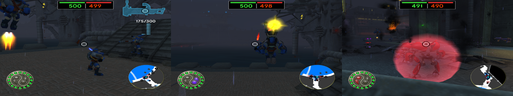
</p>

| Blue Guard | Blue Guard (Jetpack) |
|---|---|
| 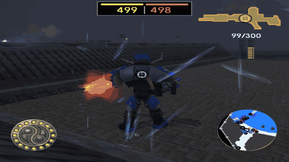 | 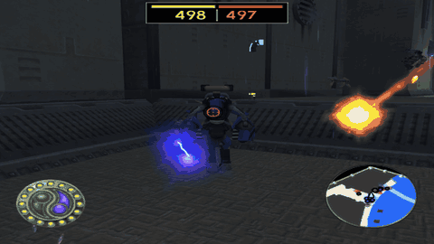 |
| **Red Krimzon Guard** | **Red Krimzon Guard (Jetpack)** |
|  | 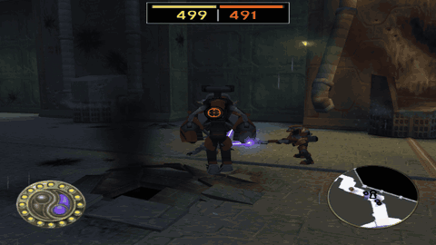 |
| **Robotguard** | **Spider Robot** |
| 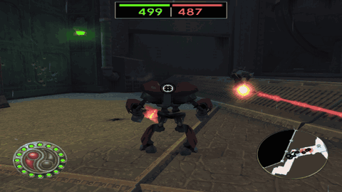 | 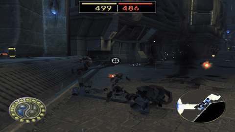 |

*Recorded in game, at the Port: every weapon of every class.*

| Camera | Guard rolls | Jetpack hovering still |
|---|---|---|
| 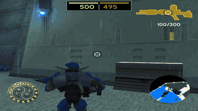 | 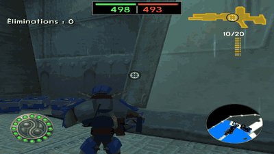 | 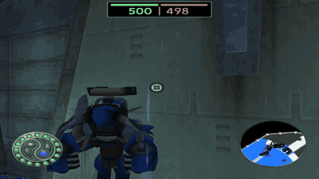 |

*Recorded in game, at the Port.*

Menus are in French when the game language is French.

## Download & Play via OpenGOAL Launcher (Players)

> [!TIP]
> **No developer environment required!** Players can install and play this mod directly using the official OpenGOAL Launcher:

### Option A — Add Custom Mod Source (Recommended)
1. In the **OpenGOAL Launcher**, navigate to **Settings ▸ Mods ▸ Add Custom Mod Source**.
2. Paste this catalog URL:
   ```text
   https://raw.githubusercontent.com/whozghiar/jak3-mod-battlefront/main/index.json
   ```
3. Go to the **Mods** tab, locate **Battlefront**, and click **Install**.
4. Select your clean PS2 game ISO when prompted. The launcher will automatically extract assets and launch the game!

### Option B — Manual Installation from GitHub Releases
1. Download the pre-built package for your operating system from the [Releases](https://github.com/whozghiar/jak3-mod-battlefront/releases) tab (`windows-v*.zip` or `linux-v*.zip`).
2. Extract the archive into your OpenGOAL Launcher features directory:
   - **Windows:** `%APPDATA%\OpenGOAL-Launcher\features\jak3\mods\_local\battlefront\`
   - **Linux:** `~/.config/OpenGOAL-Launcher/features/jak3/mods/_local/battlefront/`
3. Launch the game from the OpenGOAL Launcher.

---

## Developer Setup & Local Compilation

If you want to modify or compile this mod locally from source:

### 0. Get the Source
Already working in a clone of [`whozghiar/jak-project`](https://github.com/whozghiar/jak-project)? Switch to this mod there, keeping your extracted game data:
```bash
task modding-switch -- jak3-mod-battlefront
```
Otherwise clone it on its own; the knowledge base used by AI agents is a submodule, so clone with it:
```bash
git clone --recurse-submodules https://github.com/whozghiar/jak3-mod-battlefront.git
```
To pull the latest modding base into this mod later, run `task modding-sync-branch`.

### 1. Select the Active Game
Make sure your environment is targeting Jak 3:
```bash
task set-game-jak3
```

### 2. Binary Compilation
- **Status:** Required: the mod changes the renderer (`Shadow2.cpp`, so that a battle full of shadows does not stop the game), so build the game with `task build-release-game`.
- **Details:** The decompiler is master-dev's.
```bash
# GOAL-only mod: nothing to build — go straight to the REPL below.
# Engine / compiler C++ changed:
task build-release-game
# Decompiler or decompiler/config changed (then step 3 is mandatory):
task build-release-decomp
```

### 3. Asset Extraction
- **Status:** Required, with your Jak 2 and Jak 3 disc files in `iso_data/jak2` and `iso_data/jak3`.
- **Details:** The Jak 2 models are not in the repository: `task modding-models` makes them from your own discs (`custom_assets/jak3/models/models.jsonc`), then `task extract` bakes them into the Haven City unit levels. A launcher install does both by itself, and needs Jak 2 installed in the launcher.
```bash
task modding-models
task extract
```

### 4. Launch the Game
Run the game natively:
```bash
task boot-game
```
*(Or launch via the OpenGOAL REPL using `task repl`, then compile and run with `(mi)` and `(r)`).*

## Demonstration Video

[](https://youtu.be/{YOUTUBE_ID})

**[Watch the demonstration video on YouTube](https://youtu.be/{YOUTUBE_ID})**

> [!NOTE]
> *Demonstration videos must be hosted externally on YouTube to prevent repository bloating. Replace `{YOUTUBE_ID}` with your YouTube video ID (e.g. `MnqnybexhSA` from `https://youtu.be/MnqnybexhSA`).*

## Technical Documentation
For the complete technical breakdown, architecture, developer notes and change log, refer to:
- [`docs/modding/current_mod/battlefront_readme.md`](docs/modding/current_mod/battlefront_readme.md)

---
*(AI-assisted)*
